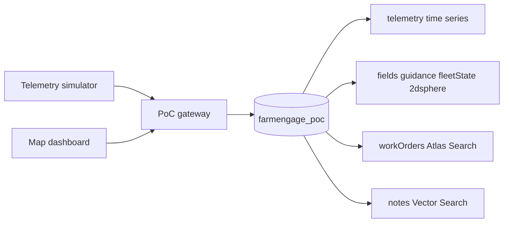

# FarmENGAGE Atlas PoC

The workspace is empty. The public contract is the [FarmENGAGE Data API](https://api-docs.farmengage.com/) OpenAPI 3.0.1, version “v September 2026”, base URL `https://api.farmengage.com/prod/externalApi/3.0` (127 paths). It has **no `securitySchemes` and no auth headers**, so this PoC does not call production. It implements the same resource shapes locally and records what a live TaskDoc send would do.

Atlas target: existing project `myAtlasGenAITestProject`, cluster **MyFreeCluster** (M0, MongoDB 8.0, AWS us-east-1), database `farmengage_poc`, via the preconfigured MongoDB connection. M0 is enough for a demo (time series, 2dsphere, Search, Vector Search). It is not the Telemetry Data Hub: keep the sample to a few thousand points, not the 30–40B historical estate.

## What the API actually provides

The three PoC stories map to these operations, not to a telemetry or ISO-XML endpoint (neither exists in the spec):

- **Field and work order:** `POST /resources/{orgId}/fields`, `PUT .../fields/{fieldId}/extent`, `POST /resources/{orgId}/guidancelines` (AB or Curve only on write; read enum also has Spiral, Pivot, Headland, Freeform), `POST /operations/{orgId}/workorders` (`cropZoneId`, `name`, `operationTypeId`, `plannedDateTime`, `dueDateTime`; max two guidance refs).
- **Display sync (Direct Send):** `PUT /operations/{orgId}/workorders/{workOrderId}/vehicletarget/{vehicleId}` and `PUT /prescriptions/{orgId}/rx/{rxId}/vehicletarget/{vehicleId}` — 204, and only when the vehicle has a TaskDoc device. Resource files (`AgData` | `AgGps`) use `PATCH /resources/{orgId}/resourcefiles/{id}/send` with status `pending | sent | canceled`.
- **As-applied samples:** `POST /tasks/{orgId}/layers/{id}/samples` (`generatedAt`, Point or Polygon, `sensorValues`). There is no live GPS stream. The PoC **simulates** mixed-OEM position/speed and writes it as time series, which is the Atlas wedge next to FarmENGAGE’s task model.

Geometry in the spec is GeoJSON-like (`Polygon`, `LineString`, `Point`) but examples and component schemas disagree on nesting. Persist **RFC 7946 GeoJSON** (`[lng, lat]`) in Atlas. Seed two fields near Ames, Iowa, not the spec’s sample coordinates.

## Architecture

One Node process serves the API and a static MapLibre page. No Payload, no second frontend build.

## Collections

- `fields`, `guidanceLines`, `prescriptions`, `workOrders`, `vehicles`, `devices` — documents shaped like the API models (`WorkOrderDetail`, `GuidancePattern`, `Prescription` + `RxPolygon`, `Vehicle` + `VehicleDevice`).
- `fleetState` — one current point per vehicle (`location` Point, speed, heading, `activeWorkOrderId`, OEM). This is what the map and `$geoWithin` read. Updating a time series measurement in place is the wrong access path.
- `telemetry` — time series collection, `timeField: "ts"`, `metaField: "meta"` (`orgId`, `vehicleId`, `oem`), `granularity: "seconds"`. Measurements: `location`, `speedKph`, `headingDeg`, `workOrderId`. Meta stays low-cardinality; speed and position are measurements.
- `syncJobs` — local record of a TaskDoc / resource-file send: `pending` then `sent`, plus a cab acknowledgement the dashboard can show. API enum stays `pending | sent | canceled`; extra progress is PoC state, not a fake FarmENGAGE field.
- `notes` — short text (work-order comments, operator notes) plus a 384-d embedding for “find a similar job”.

Indexes created at seed:

- 2dsphere on `fields.extent`, `guidanceLines.geometry`, `fleetState.location`.
- Atlas Search on `workOrders`: `name`, `comments`, `operationType`, `materialName`; `orgId` as a token filter.
- Vector Search on `notes.embedding`, 384 dimensions, cosine, filter on `orgId`.

Search and vector indexes are not put on `telemetry`. Atlas Search does not index time series collections. Recent history is a time-series aggregation; keyword and semantic search stay on operational documents.

Embeddings: local `all-MiniLM-L6-v2` via `@huggingface/transformers` so the demo needs no extra API key. Queries embed the same way.

## Demo behavior

Seed one org, two fields with polygons, one AB line each, one variable-rate prescription, and four vehicles (AGCO terminal, Trimble GFX, John Deere, Raven) each with a TaskDoc-style device. John Deere and Raven are labels on simulated vehicles, not live partner APIs.

The simulator walks machines along guidance lines inside the polygon, inserts telemetry about once a second, and upserts `fleetState`. A machine inside a field with a sent work order advances a simple covered-area fraction on that work order.

Dashboard (one page):

- Map of field polygons, AB lines, and live machine markers.
- Create a work order (field, guidance, operation, comment) and send it to a vehicle. Gateway writes the work order and a `syncJobs` row, and stores a small ISO-XML `TASKDATA` snippet as the file that would otherwise move by USB. The snippet is illustrative; the send path matches `SendWorkOrderToTaskDoc`.
- Fleet strip: last speed and status from `fleetState`; a sparkline or table from a time-series `$match` + `$group` on the last few minutes.
- Search box hits Atlas Search. A “similar work” box hits `$vectorSearch`.

## Files

- [package.json](package.json), [src/server.ts](src/server.ts) — HTTP API and static files
- [src/db.ts](src/db.ts) — client, time series collection, search and vector index creation
- [src/seed.ts](src/seed.ts) — Iowa fixtures
- [src/simulator.ts](src/simulator.ts) — mixed-fleet positions
- [src/embed.ts](src/embed.ts) — MiniLM embeddings
- [src/farmengage/types.ts](src/farmengage/types.ts) — the subset of API models we store
- [public/index.html](public/index.html) — MapLibre dashboard
- [README.md](README.md) — how to run, which API operations are real vs simulated, M0 limits

`MONGODB_URI` comes from the environment (the preconfigured Atlas connection). Do not commit it.

## Out of scope

Live OAuth against `api.farmengage.com`, John Deere/Raven partner calls, full ISO 11783, and any claim that M0 holds historical fleet telemetry. A `FarmEngageClient` function can later swap the mock writer for `fetch` to the production base URL once a bearer token exists; the spec does not document how to obtain that token.
